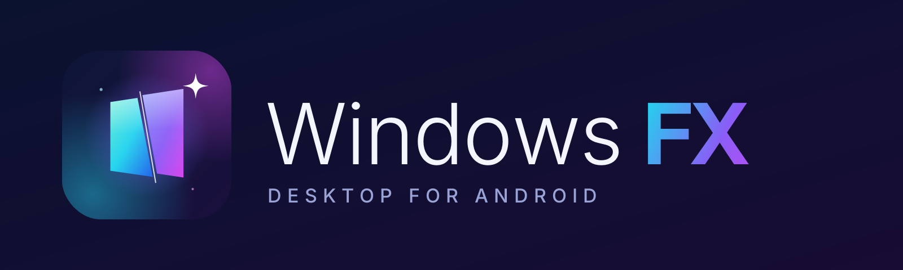

<p align="center"></p>

# WindowsFX — рабочий стол в стиле Windows для Android

WindowsFX превращает планшет или телефон в настольный компьютер: окна, панель задач, меню «Пуск», настоящие файлы устройства, Android-приложения и полноценные офисные программы.

## Что внутри (0.3)

- **Рабочий стол** на основе веб-концепта Windows 12: окна с прикреплением к краям, виртуальные рабочие столы, представление задач, виджеты, быстрые настройки, центр уведомлений, экран блокировки.
- **Проводник с настоящей памятью устройства**: диск D: — внутренняя память, E: — SD-карта; Документы, Загрузки, Изображения, Музыка и Видео — реальные папки устройства. Копирование и перемещение (в том числе перетаскиванием пальцем), корзина с восстановлением, поиск, «Поделиться», открытие в Android-приложениях.
- **Android-приложения** в «Пуске», поиске и на панели задач, запуск в окнах (если на устройстве включён оконный режим).
- **Lexicon** — текстовый редактор, аналог Word (движок [WordCraft](https://github.com/storytold/wordcraft)).
- **Tabs** — электронные таблицы, аналог Excel (движок [GridCraft](https://github.com/storytold/gridcraft)).
- **Prism** — графический редактор, аналог Photoshop (движок [PhotoCraft](https://github.com/storytold/photocraft)).
- **Браузер** на движке Chromium (Android WebView) с вкладками, закладками и загрузками.
- **Фотографии**: альбомы по папкам, жесты масштабирования, листание свайпом, слайд-шоу, видео, сведения о файле.
- **Просмотр PDF** на pdf.js: миниатюры, масштаб, поиск по тексту, ночной режим.
- Блокнот, Paint, Терминал, Калькулятор, Медиаплеер, Часы, Календарь, Погода, Камера, Сапёр, 2048, DOOM.

## Установка

1. Откройте **Releases** и скачайте последний `WindowsFX-*.apk`.
2. Установите его и нажмите «Домой» → выберите WindowsFX как рабочий стол по умолчанию.
3. Разрешите «Доступ ко всем файлам», когда WindowsFX попросит.

## Окна для Android-приложений

Android открывает приложения в окнах, только если включён системный оконный режим:
«Для разработчиков» → «Разрешить окна произвольной формы» и «Принудительно разрешить изменение размера», затем перезагрузка.
Если переключателей нет (часто на Huawei), выполните с компьютера один раз:

```
adb shell settings put global enable_freeform_support 1
adb shell settings put global force_resizable_activities 1
```

## Сборка

APK собирается GitHub Actions (`.github/workflows/build.yml`); движки Craft скачиваются при сборке.
WordCraft для Lexicon собирается отдельно (`.github/workflows/craft-web.yml`).

## Открытый код

WordCraft, GridCraft, PhotoCraft — ArtCraft, MIT OR Apache-2.0 (используются без изменений; ArtCraft — товарный знак владельцев).
pdf.js — Apache-2.0. js-dos — GPL-2.0. mobile-drag-drop — MIT.
