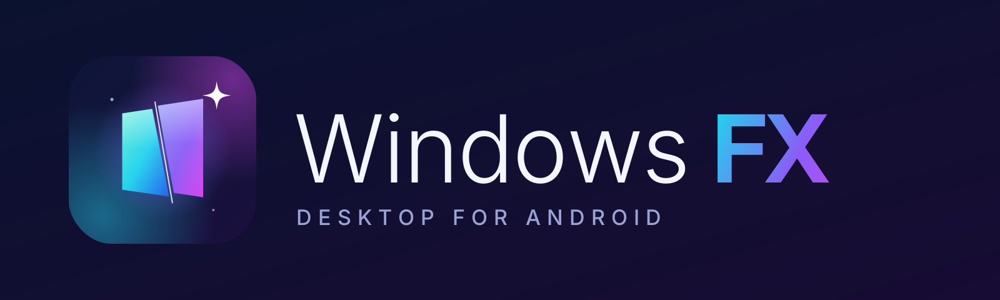

<p align="center"></p>

# WindowsFX — рабочий стол в стиле Windows для Android

WindowsFX превращает планшет или телефон в настольный компьютер: окна, панель задач, меню «Пуск», настоящие файлы устройства, Android-приложения и полноценные офисные программы.

## Что внутри (0.4)

- **Рабочий стол** на основе веб-концепта Windows 12: окна с прикреплением к краям, виртуальные рабочие столы, представление задач, виджеты, быстрые настройки, центр уведомлений, экран блокировки.
- **Проводник с настоящей памятью устройства**: диск D: — внутренняя память, E: — SD-карта; Документы, Загрузки, Изображения, Музыка и Видео — реальные папки устройства. Копирование и перемещение (в том числе перетаскиванием пальцем), корзина с восстановлением, поиск, «Поделиться», открытие в Android-приложениях.
  Как в Windows 11: **вкладки** (Ctrl+T, Ctrl+W, средняя кнопка мыши по папке), **дерево папок** слева, которое само раскрывается до открытой папки, закрепление папок в быстром доступе, стрелки «>» в адресной строке со списком вложенных папок и подсказки папок при вводе пути, **виды** от огромных значков до таблицы и плитки (Ctrl+колесо мыши), ширина столбцов, быстрый переход по первым буквам имени, **области просмотра и сведений** (Alt+P, Alt+Shift+P). На сенсорном экране папки и файлы открываются **одним касанием**, а выделение — флажками (обе настройки есть в меню «Просмотреть»).
- **Android-приложения** в «Пуске», поиске и на панели задач, запуск в окнах (если на устройстве включён оконный режим).
- **Документы** — текстовый редактор, аналог Word, с проверкой русской, английской, армянской, грузинской и азербайджанской орфографии и вкладкой «Расчёты» ([Documents-Tabes](https://github.com/Arthuralend/Documents-Tabes), на основе [WordCraft](https://github.com/storytold/wordcraft)).
- **Таблицы** — электронные таблицы, аналог Excel ([Documents-Tabes](https://github.com/Arthuralend/Documents-Tabes), на основе [GridCraft](https://github.com/storytold/gridcraft)).
- **Photostore** — графический редактор, аналог Photoshop (движок [PhotoCraft](https://github.com/storytold/photocraft)).
- **WinArchivator** — архиватор: открывает ZIP, RAR (включая RAR5), 7Z, TAR, GZ, BZ2, XZ, ZST, ISO, CAB, ARJ, LZH, WIM и другие, создаёт 7Z/ZIP/TAR/TAR.GZ/TAR.BZ2/TAR.XZ с паролем AES-256; пункты «Извлечь здесь» и «Добавить в архив» в Проводнике. Имена файлов из русской Windows (CP866) читаются правильно.
- **Видеоплеер** на движке libVLC: MKV, AVI, MP4, MOV, WMV, FLV, TS, VOB, WebM, RMVB, звук AC-3/DTS/FLAC, субтитры SRT/ASS/SSA, выбор дорожек, скорость, списки, продолжение с места остановки.
- **Общий буфер обмена с Android**: скопированное в WindowsFX (в том числе таблицы из Таблиц — с ячейками, в формате HTML) вставляется в любые Android-приложения, и наоборот. В окнах Документов, Таблиц и Photostore кнопка «Вставить из буфера обмена Android» в заголовке вставляет скопированное в других приложениях касанием, без клавиатуры.
- **Управление пальцами**: касание двумя пальцами — правая кнопка мыши, движение двумя пальцами — прокрутка (с инерцией), щипок — масштаб в Документах, Таблицах и Photostore.
- **Указатель мыши** в стиле Windows (стрелка, рука, I-образный курсор, стрелки изменения размера) вместо круглого указателя Android.
- **Браузер** на движке Chromium (Android WebView) с вкладками, закладками и загрузками.
- **Фотографии**: альбомы по папкам, жесты масштабирования, листание свайпом, слайд-шоу, видео, сведения о файле.
- **Просмотр PDF** на pdf.js: миниатюры, масштаб, поиск по тексту, ночной режим.
- Блокнот, Paint, Терминал, Калькулятор, Медиаплеер, Часы, Календарь, Погода, Камера, Сапёр, 2048, DOOM.

## Установка

1. Откройте **Releases** и скачайте последний `WindowsFX-*.apk`.
2. Установите его и нажмите «Домой» → выберите WindowsFX как рабочий стол по умолчанию.
3. Разрешите «Доступ ко всем файлам», когда WindowsFX попросит.

## Окна для Android-приложений

Android открывает приложения в окнах, только если включён системный оконный режим:
«Для разработчиков» → «Разрешить окна произвольной формы» и «Принудительно разрешить изменение размера», затем перезагрузка.
Если переключателей нет (часто на Huawei), выполните с компьютера один раз:

```
adb shell settings put global enable_freeform_support 1
adb shell settings put global force_resizable_activities 1
```

## Сборка

APK собирается GitHub Actions (`.github/workflows/build.yml`); движки Craft скачиваются при сборке.
Офисные программы собираются отдельно (`.github/workflows/craft-web.yml`): Документы и Таблицы — из
[Arthuralend/Documents-Tabes](https://github.com/Arthuralend/Documents-Tabes) (после изменений там запустите этот
workflow вручную: Actions → Run workflow), Photostore — из PhotoCraft с изменениями WindowsFX (`tools/craft-patch.sh`).
Ко всем применяется `tools/patch-egui-wgpu.sh`. Готовые сборки лежат в релизе `craft-assets`; из него их берут
APK, программа для Mac и установщик сервера, а после сборки движков APK и DMG пересобираются сами.

## Открытый код

WordCraft, GridCraft, PhotoCraft — MIT OR Apache-2.0 (изменённые версии: названия, язык, словарь; тексты лицензий лежат рядом с движками).
Русский словарь Hunspell (LibreOffice ru_RU) — © 1997–2008 Alexander I. Lebedev, лицензия BSD; в WindowsFX — изменённая версия (только формат хранения).
7-Zip (WinArchivator) — © Игорь Павлов, GNU LGPL 2.1 + ограничение unRAR; сборка 7z-wasm, исправлено чтение имён CP866.
libVLC (Видеоплеер) — VideoLAN, GNU LGPL 2.1.
pdf.js — Apache-2.0. js-dos — GPL-2.0. mobile-drag-drop — MIT.
